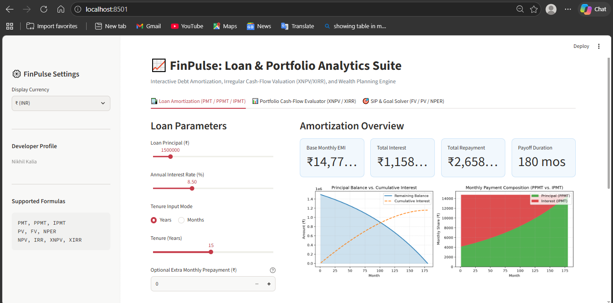
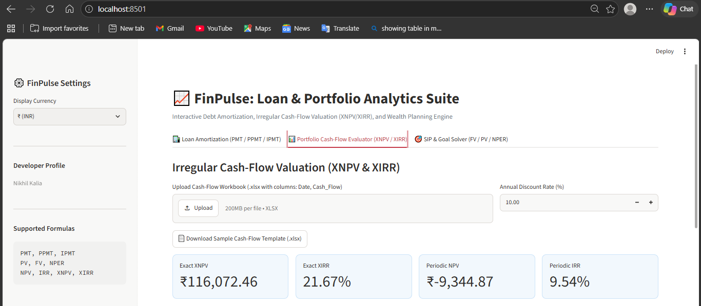
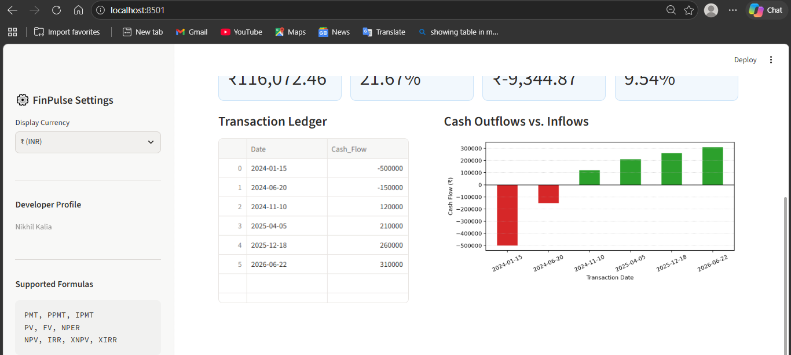

# 📈 FinPulse: Loan & Portfolio Analytics Suite

**FinPulse** is an interactive financial modeling and valuation web application built with **Python, NumPy, Pandas, Matplotlib, and Streamlit**. It translates core corporate finance and spreadsheet functions (`PMT`, `PPMT`, `IPMT`, `PV`, `FV`, `NPER`, `NPV`, `IRR`, `XNPV`, and `XIRR`) into a fast, vectorized web dashboard with zero external C-compiler dependencies.

---

## ✨ Key Features

- **🏦 Loan EMI & Amortization Simulator (`PMT`, `PPMT`, `IPMT`):**
  - Interactive sliders for Loan Principal, Annual Interest Rate, and Tenure (in Years or Months), plus multi-currency support (`₹`, `$`, `€`, `£`).
  - **Extra Monthly Prepayment Simulator:** Dynamically models how additional monthly principal payments reduce total interest payable and shorten payoff duration.
  - **Visual Analytics:** Plots principal balance decay vs. cumulative interest and a stacked area breakdown of monthly `PPMT` vs. `IPMT`.
  - **Styled Excel Export:** Generates a formatted multi-sheet `.xlsx` report (`Executive Summary` and `Amortization Schedule`) via `openpyxl`.

- **📊 Irregular Cash-Flow Valuation (`XNPV`, `XIRR`, `NPV`, `IRR`):**
  - Supports uploading custom `.xlsx` workbooks (`Date` and `Cash_Flow` columns) or testing with the included `Sample_Cash_Flows.xlsx` template.
  - Uses a custom **Newton-Raphson root-finding solver** in pure NumPy to compute exact date-weighted `XNPV` and `XIRR` alongside standard periodic `NPV` and `IRR`.

- **🎯 SIP & Time-Value-of-Money Goal Solver (`FV`, `PV`, `NPER`):**
  - **Future Value (`FV`):** Projects wealth accumulation from combined lump-sum deposits and monthly SIP contributions.
  - **Present Value (`PV`):** Calculates the single lump sum required today to achieve a future target corpus.
  - **Time to Goal (`NPER`):** Solves for the exact number of months and years needed to reach a wealth target.

---

## 📸 Dashboard Preview

### 1. Loan Amortization & Prepayment Simulator


### 2. Irregular Cash-Flow Evaluator (XNPV & XIRR)



### 3. Time-Value-of-Money Wealth Planner


---

## 🛠️ Tech Stack

- **Language:** Python 3.9+
- **Numerical Engine:** NumPy (Vectorized Financial Engine & Newton-Raphson Solver)
- **Data Processing & Excel I/O:** Pandas, OpenPyXL
- **Data Visualization:** Matplotlib
- **Web Interface:** Streamlit

---

## ⚙️ Installation & Local Setup

1. **Clone the repository:**
   ```bash
   git clone https://github.com/<your-username>/finpulse.git
   cd finpulse
   ```

2. **Install dependencies:**
   ```bash
   pip install -r requirements.txt
   ```

3. **Run the Streamlit application:**
   ```bash
   streamlit run FinPulse_app.py
   ```

---

## 📂 Repository Structure

```text
├── assets/
│   ├── Dashboard_Tab1.png       # Loan amortization & charts screenshot
│   ├── Dashboard_tab2.1.png     # XNPV/XIRR metrics screenshot
│   ├── Dashboard_tab2.2.png     # Transaction ledger & bar chart screenshot
│   └── Dashboard_Tab3.png       # SIP & Goal solver screenshot
├── FinPulse_app.py              # Main Streamlit application & NumPy financial engine
├── Sample_Cash_Flows.xlsx       # Sample irregular cash-flow dataset for testing
├── requirements.txt             # Python package dependencies
├── .gitignore                   # Git ignore rules
├── LICENSE                      # MIT License
└── README.md                    # Project documentation
```

---

## 📄 License

This project is licensed under the MIT License — see the [LICENSE](LICENSE) file for details."# FinPulse" 
"# FinPulse" 
